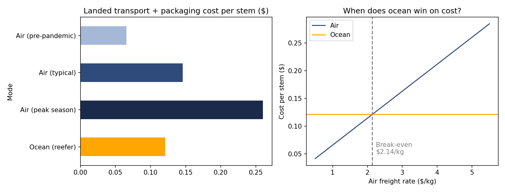
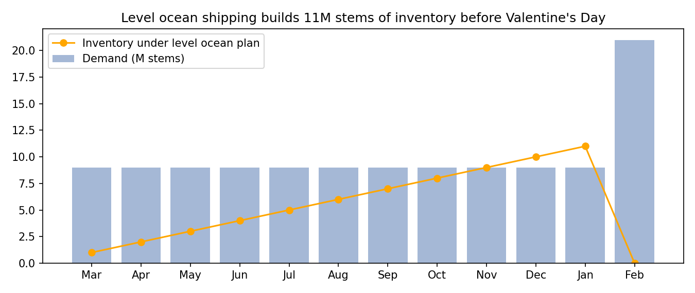

# Air vs Ocean for a Perishable Product: Cost, Carbon, and Shipping Plan

**Question:** A Kenyan rose grower ships to Europe by air. Can ocean reefer containers compete on cost, how much carbon do they save, and what shipping plan protects the Valentine's Day peak?

**Answer:** Ocean is cheaper whenever air freight costs more than **$2.14/kg** (17% cheaper at today's typical $2.65/kg) and cuts transport CO2 by **about 97%**. The open question is how to handle the February spike, and the model puts a price on each option.



## Cost and carbon per stem

| Mode | Cost per stem | CO2 per stem |
|---|---|---|
| Air, pre-pandemic ($1.00/kg) | $0.066 | 215 g |
| Air, typical ($2.65/kg) | $0.146 | 215 g |
| Air, peak ($5.00/kg) | $0.260 | 215 g |
| **Ocean reefer** | **$0.121** | **5.6 g** |

## Shipping plan for 120M stems a year (9M/month plus a 21M February peak)



| Plan | Freight + packaging | Transport CO2 | Peak inventory held |
|---|---|---|---|
| Level ocean (10M every month) | $14.5M | ~670 t | 11M stems |
| Hybrid (ocean base, fly the February surplus) | $16.2M | ~3,200 t | none |

**Recommendation:** use ocean for base demand. Before committing to a fully level plan, price the cold-storage and spoilage cost of holding up to 11M stems. The hybrid plan is worth its extra **$1.7M and ~2,500 t CO2** only if those holding losses are larger.

## What this shows
Landed-cost modelling · break-even analysis · carbon accounting (g CO2 per tonne-km) · level vs chase planning · inventory profiling

## Tools
Python · NumPy · pandas · matplotlib · Jupyter

```bash
pip install -r requirements.txt
jupyter notebook freight_mode_analysis.ipynb
```

---
*Context: built from my individual case analysis of "Sian Flowers: Fresher by Sea?" in Supply Chain Management (UBC Sauder MBA). Input figures come from the case; the model, break-even, and plan comparison are my own.*
